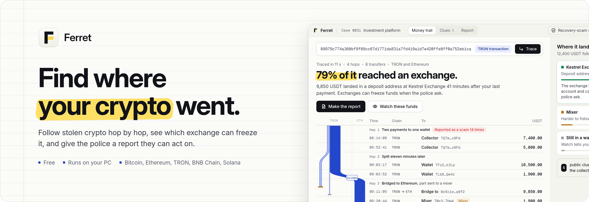
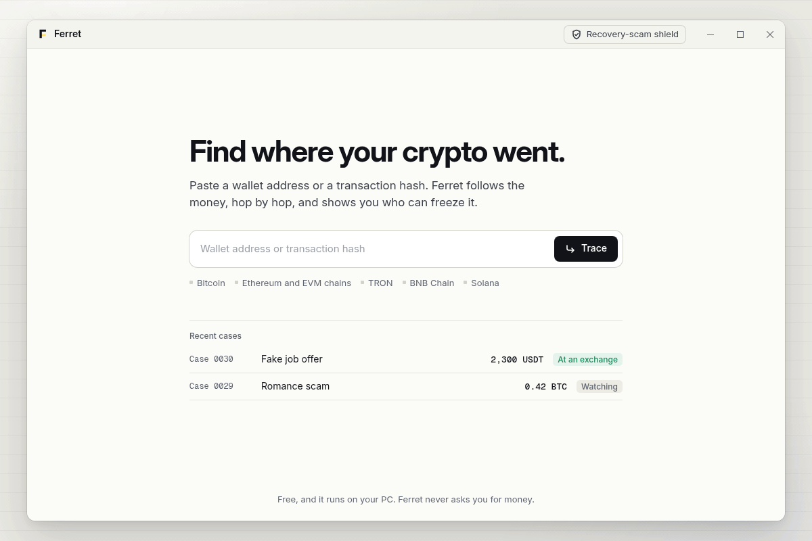
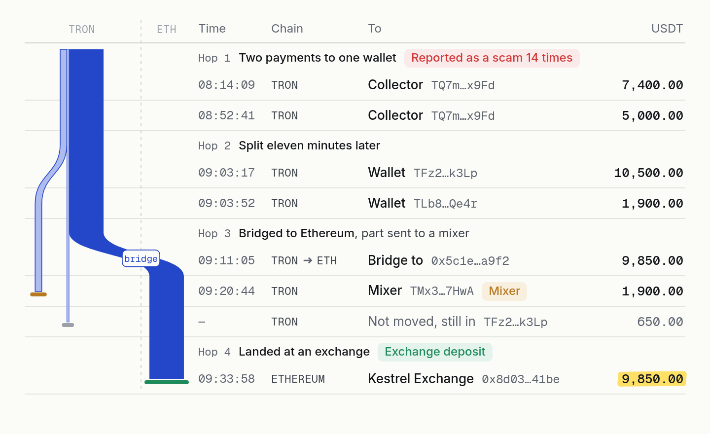
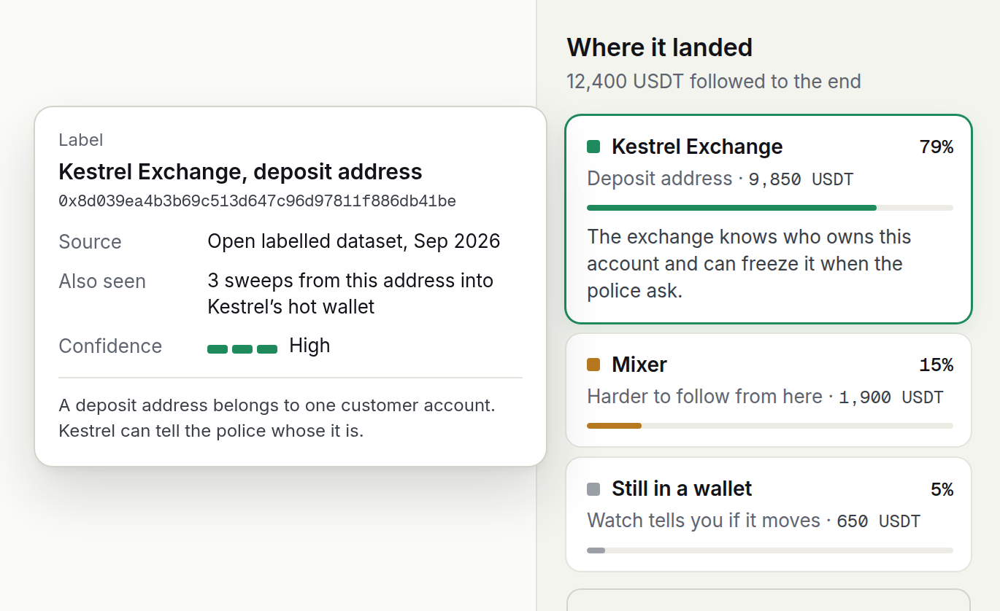
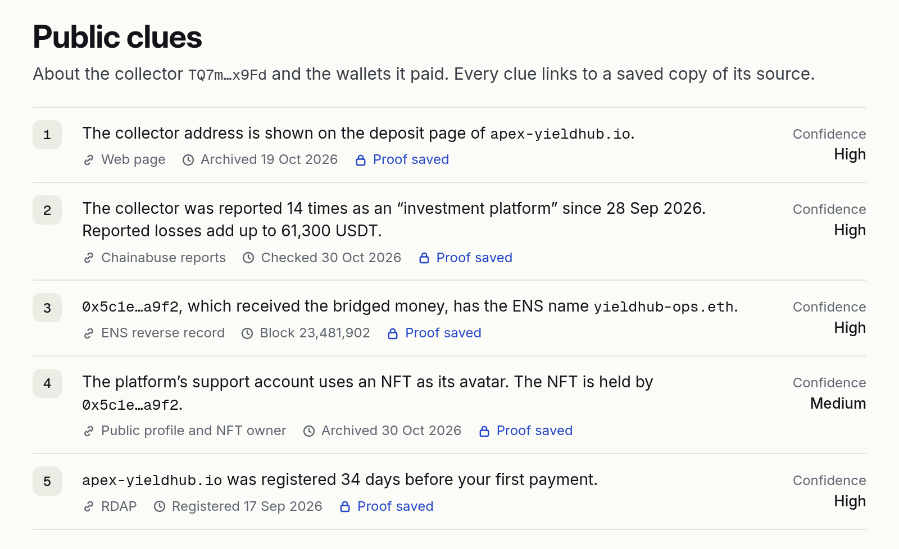
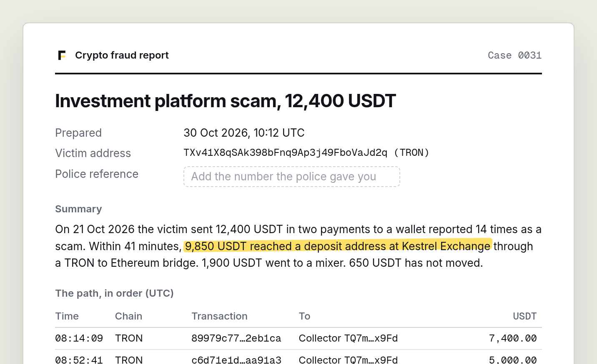
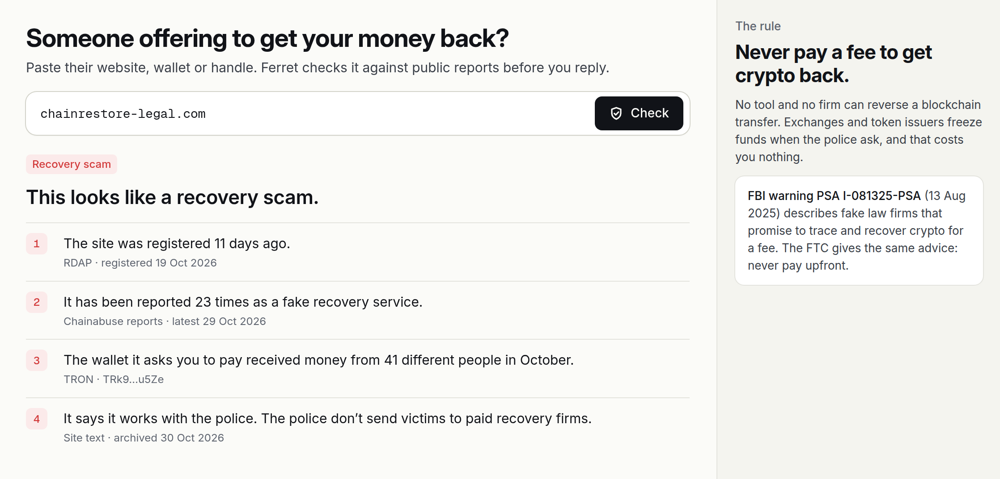

<p align="center">
  
</p>

<p align="center">
  <a href="#install"></a>
  
  <a href="LICENSE"></a>
  
  
</p>

<p align="center">
  <a href="#what-it-does">What it does</a> ·
  <a href="#install">Install</a> ·
  <a href="#recovery-scam-shield">Recovery-scam shield</a> ·
  <a href="#use-it-right">Use it right</a> ·
  <a href="#questions">Questions</a>
</p>

<p align="center">
  
</p>

<h3 align="center">Feel like ZachXBT. Find where your crypto went.</h3>

**Sent crypto to someone who vanished? The money didn't.**

Every transfer is still on the chain. Somewhere down that trail there is usually an exchange that knows exactly who opened the account. Ferret follows the trail for you. Paste one address or one transaction hash, and in seconds you get every hop, where the money stopped, who can freeze it, and a report the police can act on today.

Free. On your PC. No account. Ferret never asks you for money.

## What it does

<table>
  <tr>
    <td width="50%"></td>
    <td width="50%"></td>
  </tr>
  <tr>
    <td align="center"><sub><b>Follow the money.</b> Every hop, in order, across chains</sub></td>
    <td align="center"><sub><b>Where it landed.</b> Who can freeze it, and how sure Ferret is</sub></td>
  </tr>
  <tr>
    <td></td>
    <td></td>
  </tr>
  <tr>
    <td align="center"><sub><b>Public clues.</b> Who is behind the wallet, with proof</sub></td>
    <td align="center"><sub><b>The report.</b> Ready for the police and the exchange</sub></td>
  </tr>
</table>

## Install

One zip, attached to the [latest release](https://github.com/Signcluengine/onchain-money-trail-analyzer/releases/latest). It carries `Main.exe`, its update settings and the `ferret` runtime, so nothing else has to be installed:

| System | File |
|---|---|
| Windows 10 and 11 | [`onchain-money-trail-analyzer.zip`](releases/latest) |

1. Unpack the zip and start `Main.exe`. There is no installer and no admin prompt.
2. Paste the address you paid, or the hash of your payment, and press **Trace**.

> [!NOTE]
> `Main.exe` is code-signed, so Windows starts it without a warning. Keep `ferret` next to it: they ship together.

## Follow the money

Ferret lays the trail out like a bank statement: date and time in UTC, chain, where it went, how much. The blue strands in the margin are your money. Each one is as wide as the amount it carries. It splits where the money was split and crosses over where it was bridged to another chain. The strand that reached an exchange stays solid ink, so your best lead is the first thing you see.

It follows Bitcoin, Ethereum and EVM chains, TRON (USDT on TRON is where most scam money moves), BNB Chain and Solana, including swaps and bridges between them.

## Where it landed

Ferret names the end of every strand: an exchange deposit address, a mixer, a bridge, an address on the OFAC sanctions list, or one already reported as a scam.

The exchange deposit address is the one that matters. It belongs to a single customer account, and the exchange can freeze it when the police ask. Every label shows where it came from and how sure Ferret is. Labels can be wrong, and Ferret tells you when it isn't sure.

## Public clues

Who runs the wallet? Ferret checks public sources only: ENS names, NFTs the wallet holds or shows as an avatar, the address on a scam site's deposit page, public posts that share it, and earlier scam reports. Every clue links to a saved copy of its source and the time it was taken, so it still holds up after the scam site goes dark.

Clues point to the people running a scam, not to a named person. They go to the police, not into a public post.

## The report

One click. Your addresses, every transaction hash with its UTC time, chain, asset and amount, the path to the deposit address, a plain-words summary, and a box for your police reference number. Save it as a PDF, copy it as text, or export the transactions as CSV.

The report ends with what to do next, in order:

1. Report it to the police. In the US: [IC3](https://www.ic3.gov) and [ReportFraud.ftc.gov](https://reportfraud.ftc.gov). In the UK: [Report Fraud](https://www.reportfraud.police.uk).
2. Give them the report and ask them to request a freeze from the exchange.
3. USDT issuers freeze tokens on police requests too. The addresses in the report are all they need.

Hours matter. Money that sits at a deposit address today can be gone tomorrow.

## Recovery-scam shield

<p align="center">
  
</p>

After a theft come the "recovery experts". Paste the site, wallet or handle of anyone who offers to get your money back, and Ferret checks it before you reply.

The rule it keeps repeating: **never pay a fee to get crypto back.** No tool and no firm can reverse a blockchain transfer. The FBI warns about fake law firms that sell exactly this ([PSA I-081325-PSA](https://www.ic3.gov/PSA/2025/PSA250813)), and the FTC gives the same advice.

## Watch

Leave a case on watch and Ferret tells you when the money moves again, with the new transaction ready to add to your police report.

## Where the data comes from

| Data | Source |
|---|---|
| Bitcoin | mempool.space API, or your own instance |
| Ethereum and EVM chains | Etherscan V2 (free key) or Blockscout |
| TRON | TronGrid (free key, optional) |
| Solana | Public RPC |
| Sanctions | OFAC SDN addresses |
| Scam reports | Chainabuse |
| Names | ENS, through any Ethereum RPC |
| Labels | Open labelled datasets, in the format of [`labels/`](labels) |

No key is required. Free Etherscan and TronGrid keys raise the rate limits for big cases; paste them in **Settings**.

## Use it right

- Ferret reads public blockchain data and public pages. Nothing behind a login, no home addresses, no phone numbers.
- It names services and entities, not private people. Don't post accusations; send the report to the police and the exchange.
- Under GDPR an address can become personal data once it's linked to a person. Cases stay on your PC and keep only what the report needs.
- Ferret isn't a recovery service and never takes a fee.

## Build from source

You need Rust 1.85 or newer and the [Tauri prerequisites](https://v2.tauri.app/start/prerequisites/) for your system.

```bash
git clone https://github.com/Signcluengine/onchain-money-trail-analyzer.git
cd onchain-money-trail-analyzer
cargo test --workspace
cargo tauri build
```

| Path | What's inside |
|---|---|
| `crates/ferret-core` | Hops, labels, confidence and shares |
| `app/` | The desktop window and its icons |
| `labels/` | Address labels with their source and confidence |
| `assets/` | Images for this README |

## Questions

<details>
<summary><b>Can Ferret get my money back?</b></summary>

No tool can. Exchanges and token issuers freeze funds when the police ask. Ferret gets you to that point fast, with a report they can act on. Anyone who asks for a fee to recover crypto is almost certainly running a scam.
</details>

<details>
<summary><b>Is it really free?</b></summary>

Yes. There is no paid plan, no account and no fee. Ferret never asks you for money.
</details>

<details>
<summary><b>Does my case leave my PC?</b></summary>

Cases are stored on your PC. Ferret only sends the addresses it looks up to the public data sources listed above. There is no telemetry.
</details>

<details>
<summary><b>The trail ends at a mixer. Is that the end?</b></summary>

Often it is for a free tool. Put the case on **Watch** and include it in your report anyway: the police and the exchanges work with tools that can go further.
</details>

<details>
<summary><b>Why does a label say "Medium"?</b></summary>

Some labels come from patterns, such as a deposit address that sweeps into an exchange's hot wallet. They are usually right, but not always. Ferret shows the source so you, and the police, can check.
</details>

<details>
<summary><b>Is Ferret like Chainalysis, Arkham or MetaSleuth?</b></summary>

They're built for analysts and priced for companies. Ferret is built for the person who lost the money: paste one address, see where it went, hand the report to the police. Free, with no account.
</details>

## License

Ferret is [MIT](LICENSE) licensed. The UI bundles Inter and Geist Mono, both under the SIL Open Font License 1.1.

Exchange names, addresses and cases in the screenshots are fictional. Ferret isn't affiliated with any exchange, blockchain, data provider or law enforcement agency named here.

ZachXBT, Chainalysis, Arkham and MetaSleuth are named for comparison only. Ferret isn't affiliated with or endorsed by any of them.
